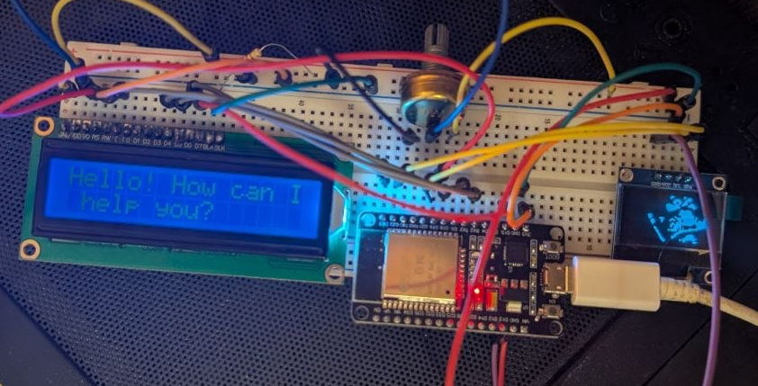

# ESP32 AI Assistant

A small embedded project that connects an ESP32 to Wi-Fi, sends a prompt to the
Google Gemini API over HTTPS, and shows the response on a 16x2 character LCD,
while a 128x64 OLED displays a bitmap graphic.

Written in C with ESP-IDF and FreeRTOS.

<!-- Add a photo or GIF of the running device here -->


## Features

- Wi-Fi station mode with event-driven connection handling (ESP-IDF event loop)
- HTTPS POST requests to the Gemini `generateContent` REST endpoint
  with TLS certificate validation (ESP x509 certificate bundle)
- JSON request building and response parsing with cJSON
- 16x2 HD44780 LCD driven in 4-bit parallel mode
- 128x64 SSD1306 OLED over I2C showing a bitmap
- Separate FreeRTOS task for the display

## Hardware

| Part | Interface | Pins |
|------|-----------|------|
| ESP32 dev board | - | - |
| SSD1306 128x64 OLED | I2C | SDA = GPIO21, SCL = GPIO22 |
| HD44780 16x2 LCD | 4-bit parallel | RS = 19, E = 23, D4 = 18, D5 = 17, D6 = 16, D7 = 15 |

## Software

- ESP-IDF (v5.x, I2C master driver API) <!-- put your exact version -->
- Components (via IDF Component Manager):
  - `espressif/cjson`
  - `k0i05/esp_ssd1306`
  - `esp-idf-lib/hd44780`

## Project structure

```
main/
├── main.c           # app entry, startup sequence
├── wifi.c/.h        # Wi-Fi STA setup and connection state
├── http_client.c/.h # Gemini API client (request/response, JSON)
├── display.c/.h     # SSD1306 OLED driver wrapper
├── display_lcd.c/.h # HD44780 LCD wrapper
├── bitmaps.h        # OLED bitmap data
└── secret.h         # credentials (NOT committed, see below)
```

## Build and run

1. Install and export ESP-IDF.
2. Create `main/secret.h` from the template:
```c
   #define WIFI_SSID      "your-ssid"
   #define WIFI_PASSWD    "your-password"
   #define GEMINI_API_KEY "your-api-key"
```
   Get a key at https://aistudio.google.com/
3. Build and flash:
```bash
   idf.py set-target esp32
   idf.py build flash monitor
```

## How it works

1. `app_main` initializes NVS and connects to Wi-Fi (blocks until connected or failed).
2. A prompt is serialized to JSON and POSTed to the Gemini API over TLS.
3. The first candidate's text is extracted from the response and written to the LCD.
4. A FreeRTOS task drives the OLED.

## Roadmap

- [ ] Periodic or button-triggered queries
- [ ] Scrolling / paginated text for responses longer than 32 characters
- [ ] Animated OLED frames
- [ ] Move credentials to `menuconfig` (Kconfig) or NVS
- [ ] Move AI request into its own FreeRTOS task

## Author
Oleksandr Pysarchuk


